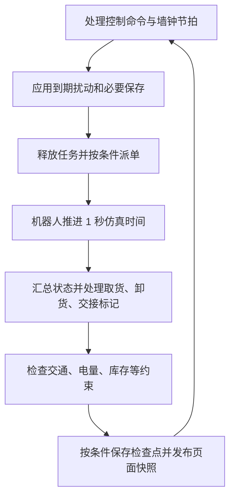

# 当前仓库主进程运行与任务派发逻辑

### 任务背景

用户希望了解当前仓库主程序怎样运行，以及任务如何进入系统、分配给机器人并完成。本文依据 2026-11-03 本地 `main` 分支源码静态追踪；没有启动仿真、访问数据库或核验当前部署进程的实际参数。

### 关键结论

- 主线是 `backend.warehouse live` → `ops/warehouse_live.py` → `WarehouseLiveRuntime` → V5 仿真器；主进程内的专属工作线程串行维护全局状态。
- 每步推进 **1 秒仿真时间**；medium 配置每 **10 秒**常规派单一次，卸货、充电或换电完成后的任务衔接可以提前触发派单。
- 任务来自数据集 `tasks.csv`，按释放时间进入系统，再通过库存与入库口容量检查；不是机器人自行生成任务。
- 当前选定策略是 **`port-guard`**：在候选批次内先尽量增加匹配数量，再保护久等、临期任务，最后优化综合成本。
- 匹配结果还须通过型号能力、SIPP 交通路径、电量和资源预约检查，才写入正式任务计划；动态检查失败会反馈到下一轮匹配。
- Ray 负责并行执行。中央仍维护任务、库存、路线预约、交接业务和结果汇总；机器人不自主选单。普通任务衔接发生在卸货或补能完成后，而非随时给运货中的机器人追加任务队列。
- 生产派单状态默认来自 `memory`；`neo4j` 是显式可选的同步状态读取方式。机器人上下文查询只用于观测，不参与选单。

#### 1. 主程序入口和职责

主要调用链：

```text
python -m backend.warehouse live [参数]
  └─ backend/warehouse/__main__.py:main
      └─ 子进程运行 ops/warehouse_live.py
          ├─ FastAPI / Uvicorn，workers=1
          │   ├─ POST /api/control：开始、暂停、单步、倍速等
          │   ├─ GET /api/snapshot：读取最新快照
          │   └─ /ws/simulation：向页面推送更新
          └─ WarehouseLiveRuntime
              └─ warehouse-live-owner 工作线程
                  └─ 仿真器 sim.step()
```

`python -m` 启动的父进程负责调用 live 脚本；真正持有仿真器并提供网页服务的是 live 服务进程。这里说的“主进程”主要指后者。

工作线程独占物理状态，网页控制通过命令队列交给它处理。它加载注册表、布局、任务、初始库存和配置，创建机器人与运行目录；恢复时校验源码、输入和配置身份。

运行时循环可以概括为：



具体业务标记在机器人返回结果的合并过程中处理，并非所有机器人合并完才统一处理。Ray 路径等待本步全部机器人返回，再按固定顺序合并；若交接改变了后续机器人的状态，会对受影响机器人重算该秒，保持既有业务语义。

`speed` 控制墙钟执行频率，不改变每步的 1 秒仿真时间，也不直接改变配置中的机器人移动速度。`ops/start_runtime.sh` 当前默认自动开始、初始请求 60 倍速；实际速度取决于规划和写入耗时。

主要源码：[入口](../../../backend/warehouse/__main__.py) 的 `main()`（第 60 行）、[服务](../../../ops/warehouse_live.py) 的 `main()`（第 348 行）、[运行器](../../../ops/warehouse_live_runtime.py) 的 `_worker()`（第 341 行）、`_advance_one()`（第 841 行）。

#### 2. 任务如何进入待派发队列

输入是固定数据集，典型字段为：

```text
task_id, task_type, goods_id, release_time, due_time, source_id, target_id
```

系统读取后转为仿真秒数，按 `(release_second, task_id)` 排好 `release_order`，用 `cursor` 逐步释放。

任务生命周期：

```text
入库：scheduled → waiting → accepted → assigned → carrying → completed
出库：scheduled → waiting → assigned → carrying → completed
```

- 入库任务释放后，必须同时满足仓库容量、目标货位空闲且未预约、入库口缓存少于 6 件，才会接收货物、预约目标货位并进入 `accepted`。
- 出库任务只有在源货位确实存放指定货物、且源货位没有预约时，才进入可派发集合。
- `_ready()` 首次确认可派发时记录 `ready_at`，后面的等待时间按这个时间计算。
- medium 使用 `port_selection_policy=balanced`。逻辑 `INBOUND` 在实际接收时绑定入库口，综合机器人接货距离、送货距离和口内积压；逻辑 `OUTBOUND` 在释放时绑定出库口，综合送货距离和已释放任务负载。

因此，任务“已释放”和“可以派发”是两个不同阶段；库存依赖和容量不足都会让任务等待。任务释放每步执行，不受 10 秒匹配周期限制。

主要源码：[任务初始化](../../../backend/wide/sim.py) 的 `_initialize_base()`、[释放与就绪判断](../../../backend/scheduling_v2/sim.py) 的 `_release()`、`_ready()`（第 189、214 行）、[自由工位绑定](../../../backend/wide/free_ports.py) 的 `release()`。

#### 3. 一轮任务派发具体怎样做

核心函数是 [V5 `release_and_dispatch()`](../../../backend/scheduling_v5/sim.py)（第 238 行）。medium 配置来自 [wheeled-medium-100.json](../../../config/wheeled-medium-100.json)。

**第一步：决定是否进入匹配。**

先释放任务；未到 `next_dispatch` 且没有可衔接机器人，就结束本次派单检查。常规间隔为 10 秒。

**第二步：筛选机器人。**

候选机器人必须无故障，并且当前没有任务计划，或启用 `task_chaining` 且已进入 `handoff_ready`。候选按电量、机器人编号排序；电量不高于 35% 的先尝试补能，不参与本轮新业务任务匹配。当前轮式配置优先换电，不可用时回退充电。

这里的 `handoff_ready` 主要表示“可以衔接下一单”，与两台机器人之间的货物接力交接不是同一含义。

**第三步：选取任务批次。**

默认从就绪任务中按以下键升序取前 32 个：

```text
（任务是否仍处于失败退避期，due_second - 0.5 × 已就绪等待秒数，task_id）
```

也就是优先看非退避任务，并结合截止时间和等待时长排序。最大匹配数量与公平性保护均针对这个有限候选池，不是对全部积压任务做一次全局最优求解。

**第四步：计算“任务 × 机器人”成本矩阵。**

```text
eta      = 机器人当前位置到取货点的路网预计时间
delivery = 取货点到交货点的路网预计时间 + 取货耗时 + 放货耗时
late     = max(0, 当前时间 + eta + delivery - 截止时间)
基础成本 = eta + delivery + 4 × late + 0.05 × 机器人累计 missions
```

当前取货、放货耗时分别为 10、12 秒；移动速度配置为 1.5 m/s。`missions` 是累计接单计数，因此有一个较小的使用次数均衡项。

混合机队有 A1 15 台、R2 15 台、X3 70 台。能力不足的任务与机器人配对直接禁用；满足能力时，还按机器人可达层数超过任务要求的层数增加软成本，尽量保留高能力机器人。每个任务另有“本轮不派发”的虚拟列。

**第五步：执行 `port-guard` 匹配。**

当前实际选定策略见 [real_scale/writer.py](../../../backend/real_scale/writer.py) 第 16 行，匹配实现见 [guarded_assignment()](../../../backend/scheduling_v5/matching.py)。其目标按优先级依次为：

1. 在静态可行配对中，尽量多分配任务。
2. 在最大匹配数量下，尽量保留按优先序可同时匹配的保护任务：就绪等待至少 300 秒，或预计完成后的期限余量不大于 120 秒。
3. 在上述约束下，用匈牙利算法优化调整后的总成本。

`port-guard` 还会给堵满入库口的已接收入库任务增加奖励，奖励随该口后续等待需求增加、最多按 6 件计算，鼓励及时取走口内货物。该奖励有容量、目标货位等前置判断，不会让不可接收的需求凭空变成可执行任务。

**第六步：对匹配结果做实际规划与提交。**

`schedule_task()` 会规划：当前位置 → 取货点 → 交货点 → 本机待命位置。当前选定规划器是 `original-sipp`，会考虑其他机器人的时空预约和终点占用；并检查任务路径及后续补能所需电量、20% 任务储备等要求。

通过后才提交交通预约，更新 `jobs[robot_id]`、机器人任务状态和任务 `assigned` 状态，并产生 `task_assigned` 事件。匹配阶段的路网 ETA 不包含完整动态避让结果，因此“匹配成功”不等于“正式派单成功”。

若规划或电量准入失败，会记录原因和阻塞者，对该机器人与任务配对退避 30 秒，并在本轮剩余候选中重新匹配，最多 3 轮。其他机器人仍可能接下该任务。

相关实现：[实际任务规划与准入](../../../backend/scheduling_v3/sim.py) 的 `_task_parts()`、`_energy_admission()`、`schedule_task()`（第 188、216、243 行），[提交交通预约](../../../backend/wide/sim.py) 的 `_commit()`（第 275 行）。

#### 4. 主进程与机器人分别做什么

| 运行选项 | 机器人执行方式 | 派单与全局业务状态 |
|---|---|---|
| `--robot-processes off`，不加 `--ray` | 主进程顺序推进各机器人 | 中央维护 |
| `--ray` | Ray MotionActor 执行运动段 | 中央维护，包括主要电量与业务更新 |
| `--robot-processes local` | 本进程内的 RobotProcess 对象持有状态和计划 | 中央维护任务、库存和预约 |
| `--robot-processes ray` | 每台机器人一个有状态 RobotActor，更新位置、电量和执行进度 | 中央派单、下发计划变更、处理业务标记并汇总 |

`--ray` 与 `--robot-processes ray` 互斥。仓库的 `ops/start_runtime.sh --ray` 当前走 MotionActor 路径；不能仅根据“开了 Ray”判断已经使用有状态 RobotActor。旧 `--robot-agents` 在 live 入口已被拒绝。

普通任务衔接的例子：机器人在 A 点卸完货后，本来要返回待命点；系统此时可以从 A 点直接规划下一单。正在前往取货点或正在载货配送的普通机器人，不会被上述候选逻辑选中追加下一单。当前也不是每个 actor 自行维护一个可自由领取、多任务排队的调度系统。

低电或故障接力是额外的中央协作流程：主进程选择满足条件的帮手机器人，预留会合及后续路线，再在交接标记处转移货物归属。`required` 历史模式另对接力规划和实际交接做历史授权；live 默认 `rules`。

源码：[执行层组合](../../../backend/warehouse/composition.py)、[本地状态与汇总](../../../backend/robot_actor/local.py)、[有状态 Ray 执行](../../../backend/robot_actor/ray_actor.py)、[MotionActor 路径](../../../backend/ray_medium/sim.py)。

#### 5. 知识图谱、保存和页面更新的位置

- `memory`：主进程使用机器人返回并合并后的内存状态派单。
- `neo4j`：需要有状态 Ray、机器人写图谱和全局服务；派单前等待完整 Step 并读取对应 tick 的机器人状态。任务和库存等中央业务逻辑仍保留。
- `--robot-graph`：机器人 actor 写自身状态和事件；`--global-writer-url` 对接独立 HTTP 全局记录服务，记录统计、协助、负责人变化与 Step。
- 有状态 Ray 的 `memory + robot-graph + global-writer-url` 可使用有界异步写入；队满时暂停推进，确认 100 台机器人真实写入成功且全局 Step 追平后释放容量。页面物理时间因此可能领先图谱已确认时间。
- 机器人上下文查询默认每 10 步执行，只记录结果、耗时与错误，不据此挑选任务。
- live 默认每 5 秒仿真时间保存 journal 和检查点，关键边界也会保存；页面通过最新内存快照及 WebSocket 更新。完成判断同时检查数据集时间范围、任务全部释放与完成、没有未完成协助，不要求所有机器人已经回到待命点。

### 执行过的操作

- 使用 `git status --short`、`git branch --show-current` 检查工作区和分支。
- 使用 `rg --files`、`rg -n`、`sed -n`、`cat`、`head` 追踪上述启动入口、运行循环、派单器、继承实现、Ray 执行层、图谱记录与配置。
- 阅读 `README.md`、`启动与图谱数据操作手册.md`，并以源码核对文档中多套历史路径与当前开关之间的区别。
- 查看 `config/live-wheeled-datasets.json`、`config/wheeled-medium-100.json` 及 sample19 的 CSV 字段。
- 本次为只读代码分析，未运行仿真或测试，未改变服务、数据库和已有实验输出。

### 修改内容

- 仅新增本文档；没有修改业务代码或配置。

### 后续建议

- 阅读源码可依次看 `_worker()` → `_advance_one()` → V3 `step()` → V5 `release_and_dispatch()` → `schedule_task()` → `_advance_robots()`。
- 如需判断某次正在运行的实例实际走哪条路径，可进一步只读核对启动命令和 `/api/snapshot` 中的 `metadata.robot_processes`、`kgStateSource`、`metadata.robot_graph_async`，本次未做部署核验。
- 当前分析无需用户确认。
