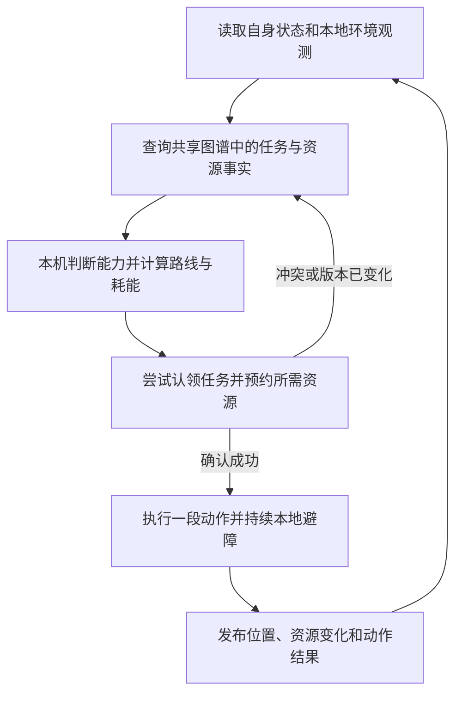

# 机器人自主决策需要的知识图谱信息

### 任务背景

用户希望先理解当前系统的分工，再讨论如果不由主程序派单，而由每台机器人自主选择任务、感知环境和决定动作，需要向知识图谱查询哪些信息。本轮为架构讲解与需求分析，没有实现自主调度、修改查询或操作运行实例。

这里将“没有主程序派单”理解为移除中央选单决策：每台机器人有自己的决策循环。任务发布、共享记录、仿真时钟、资源一致性等基础设施仍可以保留，它们并不等同于中央替机器人选单。

### 关键结论

- 当前主程序负责派单、路线与时空预约、库存、补能和交接协调，机器人进程主要执行下发计划并更新自身状态；多进程执行不等于已经自主决策。
- 自主决策时，机器人需要查询“任务、能力、货物和货位、地图和交通、能源和补能、同伴和接力、历史与恢复”等共享事实。
- 图谱是已发布知识和共享记忆；眼前临时障碍、实际位置、电量及抓取结果来自本地感知/状态。当前项目是已知地图的仿真执行链，不应描述成已经接入真实传感器自主感知。
- 查询只给出候选与证据。机器人还需本地能力判断、路径和耗能计算，以及对任务、货位、道路和补能资源的原子认领/预约。
- 自主决策不能只靠“先查没人用，再直接去做”。任务和资源可能被多个机器人同时看到，必须有版本校验、互斥预约、释放和失效处理。
- 当前图谱已有部分状态和历史，实时库存、详细预约与电池资源等仍主要在中央运行器。现有五包查询不足以直接支撑完整自主操作。
- 先前24条W查询草案以当前中央调度为基础；若转向机器人自主决策，需要重新安排其使用者，并新增任务认领与资源协调接口，不能仅把同一批Cypher放到actor里执行。

#### 1. 当前系统替机器人做了什么

| 当前主程序 | 当前机器人进程 |
|---|---|
| 根据时间发布任务，检查库存是否允许处理 | 接收自身状态和执行计划变更 |
| 结合距离、期限、电量、型号给任务匹配机器人 | 按计划每步推进位置、阶段与电量 |
| 规划取货、送货、返回和补能路径 | 返回取货、交货等动作标记 |
| 统一预约路径、货位和补能资源 | 按当前配置写本机状态/事件并执行观测查询 |
| 协调交接并更新货物、任务负责人 | 不自行从公共任务池挑选任务 |

主要依据：`backend/scheduling_v5/sim.py:release_and_dispatch()`、`backend/robot_actor/local.py:RobotProcess`、`backend/wide/sim.py` 的能力门禁、`backend/scheduling_v3/sim.py:request_assistance()`。

#### 2. 机器人自主运行的基本循环

这里的本机规划是自主方案需要增加的职责，不是当前actor已经具备的行为。共享预约机制可以由Neo4j事务或专门资源服务提供；机器人仍自行选择候选和动作，资源服务只负责互斥与一致性。

#### 3. 每个决策需要查哪些信息

| 机器人要决定什么 | 需要读取的事实 | 读取后的判断或动作 |
|---|---|---|
| 我现在能否接单 | 自身任务、载货、阶段、故障、已承诺的接应；状态观测时间 | 空闲、可衔接，还是应先恢复/补能；自身最新读数可直接本地读取 |
| 我能做哪类任务 | 型号、可达层数/高度、伸展要求、载荷限制、当前运行配置 | 检查源与目标要求，例如A1不能操作第2、3层 |
| 我应该选择哪一单 | 已释放任务、类型、货物、源目标、截止时间、优先级/等待时间、有效负责人或认领状态 | 计算候选成本和紧急程度，再尝试认领；未发布任务不进入候选 |
| 我能否取到指定货物 | 货物身份、当前所在货位或持有机器人、源货位状态与预约、取货是否已完成 | 避免拿错、重复取货，确认自己对这件货物的操作权 |
| 我能否把货放到目标 | 目标真实货位、层数、占用与预约、预约拥有者和有效期 | 确认能力与可用性，成功预约后才能前往放货 |
| 我怎样前往目标 | 仓库地图、货架/边界/固定障碍、连接关系、已解析的物理工位、附近机器人及已发布道路时段预约 | 机器人自己的规划器计算路径和时间，并尝试预约；直线距离近不代表道路可达 |
| 我该等待、绕行还是重新规划 | 相关道路预约、阻塞对象、对方已发布意图/占用期限、自己的等待时长和任务期限 | 判断是否继续等或提出新计划，不能只凭对方旧位置推断通道已空 |
| 我该继续配送还是补能 | 当前电量、耗能规则、剩余操作、候选补能点、排队和服务时间、充电位预约、可用电池及其预约 | 本机估算配送和到达补能点的总耗能，再预约充电或换电资源 |
| 我需要找谁接力 | 自己的持货和任务、求助原因、已有请求/接收者、剩余目标、同伴能力/电量/载货/忙闲/故障/接应承诺 | 选能够完成剩余任务的帮手，并发起协商和预约 |
| 我能否接受别人求助 | 请求是否仍有效、货物和任务负责人、目标能力要求、会合点/时段、自己已有任务与能源 | 评估接应、配送和补能是否可行，确认接应承诺，防止多个接收者同时接受 |
| 交接时能否改变货物负责人 | 交出者、接收者、货物唯一持有者、任务责任、双方到位状态与交接阶段 | 双方确认后原子更新归属；“查询时对方持货”不等于现在已交给自己 |
| 故障恢复后从哪继续 | 最近可信状态、实际货物持有者、已完成取货/放货/交接事件、任务责任、仍有效的预约 | 重新感知现场后恢复未完成部分，不重放已经完成的动作 |

这些不是要求每个机器人每次都查询全部信息：空闲时查询接单上下文，低电时查询补能/求助上下文，到货架前查询取放上下文。自身刚测得的电量不必先写图谱再读回来；写入用于让其他机器人和历史查询可见。

#### 4. 自主感知和图谱的分工

| 信息 | 首要来源 | 图谱的作用 |
|---|---|---|
| 自己当前实际位置、电量、是否抓到货物 | 本地状态/传感器；当前项目中由仿真状态提供 | 发布共享状态与历史证据 |
| 临时出现的人、物或近距离碰撞风险 | 本地即时感知 | 可共享发现，但不能成为紧急避障的唯一依据 |
| 货架、货位编号、可达层数和地图 | 布局与能力配置 | 保存可重复查询的静态知识 |
| 其他机器人承诺、任务归属、预约和交接 | 各机器人已确认发布的共享记录 | 为协调提供共同依据，附带版本和时间 |
| 过去做过什么、为何失败、货物交给谁 | 已提交状态与事件 | 支持解释、恢复和追溯 |

因此图谱回答的是“已记录/已确认什么”，路径规划器回答“按这些信息如何走”，本地感知继续校验实际环境。感知与图谱矛盾时要停止依赖过期事实并重新确认，不能为了保持图谱一致而忽略现场。

#### 5. 为什么仅增加查询还不够

假设A1和R2同时查询任务T，两个查询都看到“未认领”。如果两者直接出发，仍会重复执行。

需要的是：每个机器人先评估候选，然后提交带版本条件的认领请求；资源机制在互斥/事务边界内重新检查，只允许一个认领成功。失败者更新上下文、重新选单。不能把一次普通读取当作对后续执行的授权。

同样需要处理：

- 任务：唯一有效负责人、认领失效/取消/重新入队。
- 货位、充电位、电池：预约归属、有效期、确认占用与释放。
- 道路：占用时间区间、冲突检查、让行/重规划与死锁处理。
- 接力：请求状态、唯一承诺接收者、双方确认、原子持货者变更。
- 数据：实验run隔离、版本、观测时间、采样陈旧度、缺项和通信失败时的行为。

预约超时也不表示真实障碍物自动消失。尤其货物已取走、机器人停在路口等物理事实，必须先核实并处理现场，不能仅删除旧认领/预约后让别人进入。

上述机制可以不包含中央选单算法，但不能取消共享资源一致性。每台机器人独立选“离自己最近的任务”也不保证全场公平或效率，需要另外确定抢单、竞价或优先级协调策略。

#### 6. 结合当前项目，哪些可以复用、哪些需要建设

可复用：静态仓库/货位/任务事实、运行内机器人身份与部分状态采样、运行事件、执行与交接历史，以及现有能力判断、SIPP路径规划、耗能和货物转移算法。

需要先补齐或结构化：任务认领与版本、实时货物/货位状态、道路和补能资源的可查询预约、换电电池状态、有效求助与接应承诺、可靠的局部观测/意图发布。当前中央内存状态或检查点包含某些资料，并不代表已经提供给每台机器人可直接决策的图谱接口。

现有 `backend/query_c` 五包明确将路径耗能、可达充电位、资源占用、活跃求助、已预约帮手和交接可行性列为缺项；附近待命且电量足够只是粗筛，不能直接据此执行接力。

如果未来实施自主方案，先前W01～W24草案仍可作为操作清单，但原来的“中央最终验证”应改为“机器人本地计算 + 共享资源确认”。这属于新的架构接入范围，本次仅解释。

### 执行过的操作

- 核对 `backend/scheduling_v5/sim.py:release_and_dispatch()` 和 `backend/robot_actor/local.py:RobotProcess`，确认当前中央与机器人分工。
- 核对 `backend/wide/sim.py` 的任务能力限制、`backend/scheduling_v3/sim.py` 的接力与低电反馈、`backend/wheeled/sim.py` 的补能流程。
- 阅读 `backend/scheduling_v3/transactions.py` 的预约事务接口，区分查询与实际提交。
- 阅读 `backend/query_c/catalog.py`、`backend/warehouse_graph_query.py` 和前次操作上下文方案，确认已有数据、时间约定及缺项。
- 使用 `sed` 做只读源码核对，未运行仿真、数据库查询或测试。

### 修改内容

- 仅新增本文讲解文档，没有修改调度、机器人行为、查询、数据库或运行配置。

### 后续建议

- 先确认目标是否确实为机器人自行选单、规划与协商；这比只增加操作查询多出认领、预约和行为执行职责。
- 若继续设计，建议先围绕一个“空闲选单→认领→取货→放货”的完整过程，逐项标记本地感知、图谱读取、算法计算与资源确认，再扩展补能和接力。
- 本轮为概念与现状说明，无需用户确认即可阅读；没有执行自主架构改造。
